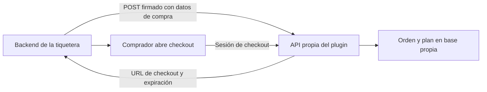
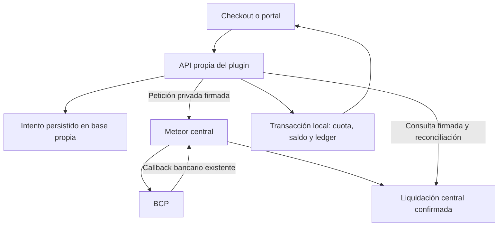

# Plugin TicketYa: resumen del proyecto, cambios y decisiones

> Actualización productiva del20/10/2026: ver [estado efectivo, accesos y pendientes](https://github.com/Presto-Ya-Team/meteor-stack-core/blob/main/docs/ticketya/production-config-completion-2026-10-20.md). La última sección de este resumen actualiza las fotografías históricas de configuración pendiente. Las funcionalidades comerciales pendientes se conservan.

Fecha de corte: **20 de octubre de 2026**.

Este documento reúne el trabajo realizado en la conversación, su implementación actual y las decisiones que todavía requieren definición comercial o comprobación en producción. Las pruebas locales y la existencia de código no equivalen a una integración activada en la nube.

## 1. Objetivo del proyecto

Ofrecer a las tiqueteras un método de pago a cuotas para entradas de eventos. La tiquetera envía los datos de la compra a nuestra API y recibe un enlace a un checkout de Plugin TicketYa. El comprador revisa su plan, acepta las condiciones y paga el anticipo. Posteriormente puede ingresar a un portal para consultar y pagar las cuotas restantes.

El producto de este trabajo es **Plugin TicketYa**. Existe otra aplicación llamada TicketYa que no debe confundirse con este checkout ni con su portal.

Los actores principales son:

| Actor | Responsabilidad prevista |
| --- | --- |
| Tiquetera | Iniciar la compra, aportar datos de evento/entradas y coordinar reserva y entrega. |
| Comprador | Aceptar el plan, pagar el anticipo y las cuotas, consultar su compra. |
| Plugin TicketYa | Mostrar checkout y portal del comprador. |
| Backend propio del plugin | Guardar órdenes, planes, accesos, intentos de pago y saldos. |
| Meteor central | Mantener la autoridad administrativa existente y atender la integración bancaria BCP. |
| Core | Controlar el registro y ciclo de vida de la aplicación y su tenant. |
| BCP | Generar los QR bancarios y confirmar los pagos. |
| Resend | Enviar los códigos de acceso del comprador. |

## 2. Repositorios y arquitectura elegida

| Repositorio | Contenido |
| --- | --- |
| [Presto-Ya-Team/plugin-ticketya](https://github.com/Presto-Ya-Team/plugin-ticketya) | Frontend React: checkout y portal «Mis cuotas». |
| [Presto-Ya-Team/meteor-stack-core](https://github.com/Presto-Ya-Team/meteor-stack-core) | Runtime propio del plugin, servicios de órdenes y financiación, identidad administrativa e integración con pagos centrales y Core. |

### Decisiones principales

| Decisión | Motivo y resultado |
| --- | --- |
| Mantener el frontend en su repositorio propio. | Permite desarrollar y publicar su interfaz de forma independiente. |
| Hacer también el portal del comprador en `plugin-ticketya`. | Comparte la interfaz y los componentes del checkout y mantiene la experiencia del comprador en un solo frontend. |
| Mantener código backend en `meteor-stack-core`, con ejecutable independiente. | Se reutilizan servicios del dominio sin arrancar todo PrestaYa para servir el plugin. |
| Usar `APPLICATION_CODE=plugin-ticketya`. | Identifica explícitamente este producto y evita mezclarlo con la otra aplicación TicketYa. |
| Separar proceso, configuración y base por aplicación/ambiente. | Las órdenes y sesiones del plugin pertenecen a su propio runtime. |
| Reutilizar BCP mediante Meteor central. | Conserva un único receptor bancario y evita copiar certificados o credenciales del banco al plugin. |
| Reutilizar el transporte Resend de Meteor. | Aprovecha el proveedor existente conservando códigos, sesiones, plantillas y configuración del plugin por separado. |
| Calcular y guardar las cuotas en el backend. | El navegador muestra el plan persistido y no decide importes, intereses o cantidad de cuotas. |
| Mantener las condiciones actuales como pruebas. | El 2 % por cuota y el máximo de tres cuotas no constituyen condiciones comerciales definitivas. |

Se conservaron nombres físicos históricos de AWS, bases y algunas colecciones. Que un nombre contenga `ticketya` o `prestaya` no significa que los procesos compartan su base o sus credenciales.

### Ejecutables y datos

- PrestaYa mantiene su entrada Meteor: `server/main.ts`.
- El plugin tiene entrada independiente: `scripts/ticketya-runtime.mts` → `server/ticketya/main.ts`.
- Su imagen se construye con `infra/ticketya-production/runtime.Dockerfile`.
- La base del plugin es `ticketya_development`, `ticketya_staging` o `ticketya_production`, según ambiente. Las pruebas usan bases locales con nombres aleatorios autorizados.
- El runtime aislado utiliza dependencias públicas y no importa el contexto global de Mongo/BCP de PrestaYa.

## 3. Cómo evolucionó el trabajo

1. Se inició el frontend en la raíz del proyecto, sin una carpeta de aplicación adicional.
2. Se construyó primero la interfaz y se trabajó inicialmente con datos y QR de prueba.
3. Se incorporó el tema Ocean Breeze de shadcn/tweakcn y se unificó la moneda a bolivianos.
4. Se decidió que las cuotas vendrían calculadas por el backend, sin selector de planes en el checkout.
5. Se creó la administración de tiqueteras y la API para recibir órdenes y devolver el enlace de checkout.
6. El checkout pasó a consumir órdenes reales persistidas y su calendario de pagos.
7. Las reglas iniciales de dos/tres cuotas según cercanía al evento fueron sustituidas por el modelo `TICKET_FINANCING_V3`.
8. Se incorporaron el temporizador de sesión y las acciones fijas para móvil.
9. Se desarrolló un primer adaptador BCP ligado al contexto original de Meteor.
10. Se separaron la base y el runtime del plugin. El adaptador antiguo dejó de ser apropiado para esa separación.
11. Se implementaron identidad administrativa compartida, portal del comprador y separación explícita del producto.
12. Se conectó el runtime propio al protocolo de control de Core por NATS.
13. Se implementó la API privada de pagos centrales para reutilizar BCP sin acceder a otra base desde el plugin.
14. Se conectaron el anticipo y las cuotas posteriores a esa integración y se añadió recuperación de confirmaciones sin navegador.
15. Se añadió Resend al acceso del comprador, reutilizando el transporte de envío existente en Meteor.
16. Se analizaron los documentos Madness. Ese análisis no cambió las fórmulas ni aprobó condiciones nuevas.

## 4. Frontend implementado

### Tecnología y componentes

- React y TypeScript con Vite.
- Tailwind y componentes shadcn/ui.
- Tema Ocean Breeze solicitado mediante el registro de tweakcn.
- React Router para navegación.
- React Hook Form y Zod para formularios y validación.

### Checkout

- Página de pago en `/pago?session=TOKEN`.
- Datos del evento, tiquetera, tipos de entrada, cantidades e importes.
- Moneda BOB, presentada como Bs.
- Desglose de precio original, precio vigente, anticipo, financiación, intereses y total.
- Timeline de cuotas con importes, fechas y estados obtenidos de la orden.
- Formulario del comprador y aceptación de la versión de condiciones.
- Temporizador basado en la expiración guardada, con sesión de hasta 30 minutos.
- Barra inferior fija en móvil con acciones y temporizador.
- Estados de carga, error, sesión inválida o vencida y operación en revisión.
- Diálogo de QR BCP y consulta del estado de pago.
- Confirmación que vuelve a consultar el backend; no confía en un estado de pago enviado por el navegador.

La selección de cuotas se eliminó de la interfaz por decisión del producto. Abrir `/pago` sin sesión tampoco carga una compra ficticia.

### Portal del comprador

- Acceso en `/mis-cuotas` mediante correo y código de seis dígitos.
- Lista de compras con pagos registrados y vinculadas al correo verificado.
- Detalle en `/mis-cuotas/:orderId`.
- Saldo, historial y calendario de cuotas pagadas, pendientes o vencidas.
- Pago por QR de la siguiente cuota pendiente, en secuencia.
- Actualización de la compra después de confirmar el pago en el backend.
- Sesión persistente con cookie HttpOnly y cierre de sesión.
- Manejo de listas vacías, errores y paginación.

El portal se abre como página propia, fuera del iframe de la tiquetera, para que el login no dependa de cookies de terceros dentro del iframe.

## 5. Administración de tiqueteras

Se desarrollaron la lista de tiqueteras y el alta mediante diálogo con componentes shadcn. En el trabajo local se creó una tiquetera de prueba llamada **Tiquetera Fabri**; esto no acredita su alta ni la validez de esa misma credencial en producción.

Cada tiquetera tiene identificador de cliente y secreto para firmar solicitudes. El secreto se entrega al crear la credencial y se conserva cifrado en el backend; el listado no lo vuelve a revelar.

El acceso administrativo requiere permisos del producto y scope correcto. No se da acceso al plugin automáticamente a todos los usuarios de PrestaYa.

Las credenciales de tiqueteras son diferentes de las credenciales de pagos centrales, de identidad administrativa y de NATS.

## 6. API de órdenes y contrato con la tiquetera

### Flujo implementado



La tiquetera llama a una **API**, no directamente a MongoDB. La integración puede abrir el enlace en un iframe; los permisos de embedding del ambiente de despliegue deben comprobarse con la tiquetera real.

La posibilidad inicial de alojar una función en Lambda se discutió como alternativa. La implementación actual de la API de órdenes es un servidor HTTP Node en el runtime independiente; no se creó una Lambda de órdenes durante este trabajo.

### Datos principales recibidos

| Grupo | Datos |
| --- | --- |
| Compra | `externalOrderId`, moneda `BOB`, total. |
| Evento | ID, nombre, fecha/hora, zona horaria IANA y lugar opcional. |
| Entradas | ID y nombre del tipo, cantidad, precio original y precio vigente por unidad. |
| Identificación opcional | `ticketId` cuando la tiquetera lo proporciona. |

Los importes de la API se expresan en **centavos enteros**: Bs 1.200 corresponde a `120000`. Un `ticketId` recibido no constituye por sí mismo prueba de reserva, emisión o entrega de la entrada.

### Rutas del checkout

| Método y ruta | Función |
| --- | --- |
| `POST /api/v1/ticket-orders` | Crear/reutilizar una orden mediante petición HMAC y devolver la URL de checkout. |
| `GET /api/v1/ticket-checkout/session` | Consultar evento, entradas, plan y expiración mediante sesión Bearer. |
| `POST /api/v1/ticket-checkout/payment-qr` | Guardar aceptación y solicitar el pago del anticipo. |
| `GET /api/v1/ticket-checkout/payment` | Consultar el pago y su proyección en la orden. |

La creación se autentica con `x-ticketera-client-id`, timestamp, nonce, firma e `idempotency-key`. La firma vincula el método, ruta y cuerpo. Se controlan replays, conflictos de idempotencia y pertenencia a aplicación, tenant y ambiente.

El navegador conserva su enlace de checkout, pero las consultas al API usan `Authorization: Bearer`. Las claves de la tiquetera no se incluyen en React.

## 7. Cálculo financiero que está implementado

Los valores actuales corresponden a pruebas autorizadas por el usuario. El análisis posterior de Madness no los sustituyó.

| Concepto | Regla actual |
| --- | --- |
| Anticipo | 25 % del precio original anunciado. |
| Capital financiado | Precio vigente al contratar menos anticipo. |
| Interés por cuota financiada | Precio vigente al contratar × tasa por cuota. |
| Interés total | Número de cuotas financiadas × precio vigente × tasa. |
| Total financiado | Capital financiado + interés total. |
| Total a pagar | Anticipo + total financiado. |
| Tasa local de prueba | 2 % por cuota. |
| Máximo local de prueba | Tres cuotas financiadas, además del anticipo. |

### Ejemplo utilizado

Precio original Bs 1.500; precio vigente Bs 1.800; anticipo Bs 375; capital Bs 1.425; tres cuotas financiadas al 2 % de prueba. El interés total es Bs 108, las cuotas son Bs 511 y el total es Bs 1.908.

### Calendario y precisión

- Mínimo de siete días calendario entre pagos, incluido el anticipo y la primera cuota.
- Preferencia por los días 10 y 25 si respetan la separación y el espacio disponible.
- Última cuota programada como máximo en la víspera del evento.
- Reducción automática de la cantidad de cuotas si no cabe el máximo.
- Rechazo de la financiación si no cabe ninguna cuota válida.
- Cálculo según zona horaria del evento.
- Cálculo monetario exacto en centavos, redondeo de totales y sobrante en la última cuota.
- Validación de que el precio vigente no sea menor al anticipo.
- Comisiones actuales del plan: `feesMinor=0`; no se aplicó el 5 % sugerido en Madness.

La orden guarda precios, tasa, versión de términos, fechas e importes. Los planes anteriores se conservan como fueron cotizados. Al confirmar el anticipo se comprueba el calendario: si coincide se consolida; si requiere cambios se registra el pago y la orden queda en revisión, sin reescribir silenciosamente lo aceptado.

## 8. Identidad administrativa y Core

### Identidad compartida de administradores

Se reutiliza la autoridad existente de Meteor Accounts y sus mecanismos de autenticación y factores. El runtime del plugin usa un consumidor autenticado y permisos por producto, aplicación, tenant y ambiente.

Se implementaron redirección de login, intercambio de código de un solo uso con PKCE, introspección y cierre de sesión. Las operaciones sensibles vuelven a validar los permisos. Se conservan cookies propias y protecciones CSRF; no se copian hashes de contraseñas ni factores entre bases.

Esto es distinto del login por correo del comprador. La implementación no prueba que los usuarios administrativos ya tengan sus grants correctos en el ambiente productivo.

### Conexión con Core

Se contrastó el protocolo real de Core y se implementó la comunicación por NATS:

- Identidad propia `plugin-ticketya-${APP_ENV}`.
- Conexión autenticada y TLS fuera de desarrollo local.
- Registro del runtime, manifiesto y heartbeat.
- Consumo de comandos de aplicación y tenant de sistema.
- Proyecciones de estado, inbox para deduplicar y outbox con reintentos.
- Bloqueo de disponibilidad y de mutaciones cuando el estado no autoriza operar.
- Recuperación de conexión y protección frente a mensajes ajenos o entregas antiguas.

El plugin se adjunta a un consumidor durable preaprovisionado. No administra streams ni otros recursos compartidos de NATS y no lee la base Core.

Un ACK de JetStream acredita persistencia en NATS; no demuestra que el Core desplegado ya haya procesado el registro. Esa comprobación forma parte de la aceptación operacional.

## 9. Integración BCP y liquidación de cuotas

### Por qué se cambió el primer adaptador

El adaptador inicial dependía de la configuración y base globales de Meteor. Después de separar el runtime y la base del plugin, se implementó un puente soportado de pagos centrales para no mantener esa dependencia.

### Flujo actual



El callback registrado sigue siendo `https://app.prestaya-latam.com/api/v1/integrations/bcp/callback`. No se creó otro receptor del banco en el plugin.

### Cambios implementados

- API privada de Meteor: `POST /api/v1/plugin-payments/ready`, `/create` y `/read`.
- Autorización por consumidor y target fijo del plugin.
- Solicitudes firmadas, timestamp, nonce y respuestas firmadas.
- Correlación por consumidor, aplicación, tenant, ambiente, orden y número de cuota.
- Anticipo identificado como cuota `0`; las cuotas financiadas mantienen su numeración.
- Nueva fuente interna BCP: `PLUGIN_TICKET_PAYMENT`.
- Registro central de la liquidación dentro de la transacción del inbox BCP.
- Actualización de la base del plugin mediante una transacción propia y ledger único.
- Estado final de compra `PAID` después de completar todos los pagos.
- Worker de recuperación cada diez segundos; consultas pendientes espaciadas y leases para evitar trabajo concurrente sobre el mismo intento.
- Recuperación sin requerir que sigan abiertos el navegador o el checkout.

Un QR generado o escaneado no acredita un pago. Un resultado `paid` sin liquidación central comprobable se trata como revisión. Se verifican importe, moneda e identidad y se evita acreditar dos veces una confirmación.

Ante timeout, vencimiento o resultado incierto, se conserva la referencia. No se genera automáticamente un segundo cobro. La configuración actual admite entre **Bs 1 y Bs 1.000 por QR**. No se divide una cuota para adaptarla a ese límite.

Las pruebas utilizaron un adaptador bancario de prueba; no se generaron ni cobraron QR reales durante esta entrega.

## 10. Correos OTP: decisión de usar Resend

El portal se preparó inicialmente con SES y buzón local. Después se verificó que Meteor ya implementaba Resend para sus OTP y se acordó reutilizar ese proveedor.

Se extrajo el transporte compartido a `server/email/resend.ts`, utilizado por los adaptadores existentes de Meteor y por el correo del comprador del plugin. Las plantillas, credenciales y estados de cada producto siguen separados.

El plugin admite `disabled`, `local`, `resend` y `ses`. Resend permite usar la cuenta existente, con configuración explícita del plugin y preferentemente una clave que pueda revocarse por separado.

Variables para activar Resend en el backend:

```dotenv
PLUGIN_BUYER_EMAIL_MODE=resend
PLUGIN_BUYER_EMAIL_FROM=<remitente verificado en Resend>
PLUGIN_BUYER_RESEND_API_KEY=<clave privada autorizada>
```

El runtime no hereda automáticamente `RESEND_API_KEY` ni `RESEND_FROM_EMAIL` de PrestaYa. Estas claves tampoco pertenecen a Vite.

Se verificaron idempotencia por challenge/scope, timeout, errores del proveedor, respuestas inválidas y acceso con código de un solo uso. Un ID devuelto por Resend prueba aceptación del envío, no recepción en el buzón. No se enviaron correos reales en esas pruebas.

**Usar Resend no requiere habilitar SES.** SES se conserva como alternativa.

## 11. Persistencia y separación de aplicaciones

La versión actual del esquema del plugin es **6**.

| Grupo | Información persistida |
| --- | --- |
| Tiqueteras | Identidad, credencial cifrada y scope. |
| Órdenes y sesiones de checkout | Compra, plan, aceptación y expiración. |
| Libro de pagos | Confirmaciones con identidad bancaria única. |
| Operadores | Flujos de login y referencias de sesión. |
| Compradores | Challenges de correo, sesiones y límites de acceso. |
| Core | Estado proyectado, inbox y outbox. |
| Intentos de pago | Obligación, correlación y recuperación de confirmaciones. |
| Metadata | Propiedad del plugin, aplicación, tenant, ambiente y versión de esquema. |

La revisión de separación exigió propiedad explícita de Plugin TicketYa. Una base genérica anterior o con otro binding no se adopta automáticamente. Se conservan las sesiones de operadores y compradores durante actualizaciones compatibles.

Core introdujo esquema 5; pagos centrales introdujo esquema 6. Añadir Resend no cambió el esquema. El rollback actual requiere una imagen compatible con esquema 6 y sus estados/datos; borrar metadata o cambiar UUID para forzarlo no es un procedimiento de migración.

## 12. Despliegue, ramas y estado comprobado

### Ramas y commits

Se trajeron cambios de `dev` de Meteor y se integró el trabajo del plugin sobre esa base. Las entregas iniciales de aislamiento se incorporaron a `main` y `dev` según se solicitó. Más adelante se trabajó directamente en `main` para el portal y las integraciones autorizadas. No se presume que todos los commits recientes estén también en `dev`.

Referencias principales en Meteor:

| Commit | Cambio |
| --- | --- |
| `99c704d` | API inicial de tiqueteras/órdenes y primer flujo BCP. |
| `1c4544d` | Integración del aislamiento de base y runtime en `main`. |
| `2a6c42b` | Integración del runtime aislado en `dev`. |
| `e64386e` | Integración de identidad administrativa compartida y grants. |
| `a61969d` | Backend del portal del comprador por correo. |
| `8896678` | Binding explícito de Plugin TicketYa en runtime y despliegue. |
| `c1c9d35` | Consumidor, registro y comunicación con Core. |
| `2647a06` | Pagos centrales BCP y liquidación de cuotas. |
| `bcd3512` | Resend compartido para los OTP del plugin. |

Referencias principales en el frontend:

| Commit | Cambio |
| --- | --- |
| `2044def` | Checkout a cuotas y primera conexión BCP; integrado por la PR #1. |
| `188bc68` | Portal del comprador y detalle de cuotas. |
| `213e557` | Identificación explícita de artefactos como Plugin TicketYa. |
| `354b692` | QR de cuotas del comprador conectado al API. |
| `cdd02d6` | Documentación del uso de Resend. |

Este resumen se apoya en el código hasta `bcd3512` de Meteor y `cdd02d6` del frontend. No atribuye a este trabajo los demás cambios concurrentes de PrestaYa ni todos los recursos de infraestructura ya existentes.

### URLs públicas

| Uso | URL |
| --- | --- |
| Frontend del plugin | `https://plugin.prestaya-latam.com` |
| Checkout | `https://plugin.prestaya-latam.com/pago` |
| Portal del comprador | `https://plugin.prestaya-latam.com/mis-cuotas` |
| API propia | `https://api-tickets.prestaya-latam.com` |
| Meteor central / autoridad | `https://app.prestaya-latam.com` |

El handoff previo informó que la infraestructura base y la publicación estática estaban aplicadas. No se volvió a tratar esa provisión como una tarea nueva pendiente. La configuración privada y las integraciones reales requieren comprobación del operador.

En la última comprobación HTTP de esta conversación, el frontend público respondió **200** y los endpoints de salud de la API pública respondieron **502**. Ese resultado es una observación de ese momento, no un monitor permanente.

### CI y activación

- Última suite local completa: **839 pruebas, 838 correctas, una omitida, cero fallos**.
- Se comprobaron TypeScript, arquitectura y build del runtime aislado; el frontend también compiló y pasó lint en su última modificación de interfaz.
- Para `bcd3512`, el job **Verify exact SHA** del workflow PrestaYa CI/CD terminó correctamente.
- Ese mismo workflow falló después en **Deploy app with automatic host rollback**, del job `deploy-production-v1`. La causa de ese fallo de despliegue no fue auditada al redactar este resumen.
- Los workflows posteriores de TicketYa terminaron correctamente, pero su resultado no demuestra por sí mismo publicación o activación del backend: la publicación puede omitirse por los controles de aceptación.
- `release-acceptance.json` sigue sin registrarse como aceptación completa. Las rutas de negocio en producción conservan bloqueos explícitos y la política financiera provisional no habilita cobros productivos.

CI de referencia: [PrestaYa CI/CD](https://github.com/Presto-Ya-Team/meteor-stack-core/actions/runs/39375932711) y [TicketYa runtime production](https://github.com/Presto-Ya-Team/meteor-stack-core/actions/runs/39376915274).

### Variables y responsables

| Componente | Configuración principal |
| --- | --- |
| Frontend | `VITE_TICKET_API_BASE_URL`, `VITE_BUYER_API_BASE_URL`: orígenes públicos. |
| Runtime | `APP_ENV`, `APPLICATION_CODE`, `APPLICATION_ID`, `SYSTEM_TENANT_ID`, versión/digest, conexión Mongo propia y clave de cifrado propia. |
| Identidad | Consumidor `TICKETYA_IDENTITY_*`, API propia y retorno autorizado; autoridad y grants en Meteor. |
| Core | `PLUGIN_CORE_*`: listener, identidad, credencial propia, CA y API pública. Consumidor/importaciones aprovisionados por el operador. |
| Pagos, lado plugin | `PLUGIN_PAYMENTS_URL`, `PLUGIN_PAYMENTS_CLIENT_ID`, `PLUGIN_PAYMENTS_CLIENT_SECRET`. |
| Pagos, lado central | `PLUGIN_PAYMENTS_CONSUMERS_JSON` con consumidor y target exactos. BCP conserva su configuración existente. |
| Correo | `PLUGIN_BUYER_EMAIL_MODE`, remitente y `PLUGIN_BUYER_RESEND_API_KEY` en el secreto del backend. |

## 13. Prueba local preparada

Se levantó una prueba del código actual con:

- Frontend en `http://localhost:5174`.
- API aislada en `http://localhost:3131`.
- Mongo replica set local en el puerto `27028`.
- Una base de prueba propia y una orden de «Festival de prueba».
- Tiquetera local de ejemplo y petición de creación firmada.
- Plan actual de prueba y checkout con expiración de 30 minutos.
- Modo de correo local, con archivos en `.tmp/plugin-local-preview-mailbox` del repositorio Meteor.

Se comprobaron respuesta HTTP 200 del frontend, API `ready` y consulta de la orden con moneda BOB y tres cuotas financiadas. Esa prueba local no tiene configurados BCP ni Resend reales. Un portal sin compras pagadas puede autenticar al comprador, pero muestra una lista vacía.

Los enlaces con sesión expiran; por eso este documento no conserva el token de la prueba. Los procesos locales dependen de que sigan abiertos y no sustituyen un despliegue.

## 14. Documentos comerciales analizados y decisiones que no se tomaron

### Documento inicial de especificación

El texto aportado inicialmente definió la base de cálculo actual: anticipo del 25 % sobre precio original, interés sobre precio vigente, separación mínima de siete días, preferencia 10/25 y vencimiento programado antes del evento.

También mencionó multas, pagos parciales, regularización, cesión de entrada con deuda y otras operaciones. Eso no significa que estén implementadas ni que sus porcentajes, topes y condiciones pendientes hayan sido aprobados. El cobro actual exige el importe completo de la obligación y su secuencia; no implementa todavía abonos parciales generales.

### `Madness.xlsx` y `Copia de Documento madness.pdf`

Se revisaron como propuesta comercial y financiera, **sin aplicar cambios al código**.

Hallazgos que deben conservarse al tomar decisiones:

1. El PDF propone adelantar a la productora el importe acordado y asumir la cobranza/riesgo desde PrestaYa. La liquidación a la productora no está implementada por registrar los pagos entrantes de BCP.
2. El Excel reúne varias versiones de planes; un apunte del 25 % inicial convive con anticipos fijos. No hay una única tabla aprobada para todas las entradas.
3. La hoja «Ejemplo» propone tasas por rango de precio y días hasta el evento, y máximos de una a siete cuotas. No se sustituyeron por ellas el 2 % y máximo tres de las pruebas actuales.
4. Esa matriz tiene límites de días solapados y no aclara inequívocamente si el máximo incluye el anticipo. También aparecen referencias a interés mensual y por cuota.
5. El 5 % de pasarela aparece en el Excel, pero los bloques y fórmulas no dejan uniforme su aplicación. No se decidió cobrarlo al comprador.
6. El PDF escribe Bs 249 más tres cuotas de Bs 249 y total Bs 1.056. La suma correcta de esos importes es Bs 996; Bs 1.056 corresponde a Bs 249 más tres cuotas de Bs 269, como figura en su flujo de caja.
7. El reparto propuesto de lo recaudado en impagos es 40 % PrestaYa / 60 % productora, o 50/50 al alcanzar al menos el 80 %. Es un reparto entre empresas, no una política de devolución al comprador.
8. Falta conciliar ese reparto con la propuesta de pagar todo a la productora al inicio.
9. Los archivos no fijan suficientemente reembolsos, cancelación del evento ni momento de emisión/entrega de la entrada.
10. El PDF contiene escenarios de venta iniciada en octubre de 2025; no se trasladaron esas fechas históricas a reglas automáticas para nuevos eventos.

El diagrama de solicitud muestra evaluación básica, identidad, contrato y autorización adicional para descuento directo. No demuestra que esos procesos estén implementados en el plugin. El «código único» del diagrama tampoco está definido como una entrada válida o QR de acceso.

## 15. Entradas y comunicación con tiqueteras: límite actual

Al completar las cuotas se registra la compra `PAID`. Todavía no se implementaron:

- Reserva/inventario garantizado con la tiquetera.
- Notificaciones automáticas a la tiquetera por anticipo o pago completo.
- Emisión, recepción, custodia o entrega de la entrada.
- Confirmación de que el comprador recibió una entrada válida.
- Liberación/cancelación coordinada de reservas.
- Liquidación del importe acordado a la productora.

Se planteó como opción que la tiquetera conserve la emisión, reciba una notificación autenticada y entregue la entrada al comprador, devolviendo una confirmación. También podría entregar el archivo al plugin si así se acuerda. No se eligió ni implementó todavía una de esas alternativas.

El QR bancario sirve para cobrar. No es el QR de acceso al evento.

## 16. Lista original de pendientes, actualizada

Se mantiene la lista acordada de siete puntos. Los subtemas anteriores explican esos puntos y no constituyen una aprobación de nuevas condiciones o funcionalidades.

| N.º | Trabajo | Estado al cierre de este resumen |
| --- | --- | --- |
| 1 | Activar acceso de administradores. | Identidad y permisos implementados; falta comprobar configuración y asignación real de usuarios en producción. |
| 2 | Conectar Plugin TicketYa con Core. | Código y pruebas implementados; pendiente activar/verificar el consumidor y binding reales. |
| 3 | Completar BCP. | Anticipo, cuotas, correlación y recuperación implementados; pendiente configuración de consumidor y prueba bancaria desplegada. |
| 4 | Enviar códigos de acceso. | Implementado con Resend; sustituye la necesidad de habilitar SES. Pendiente configurar remitente/clave y probar recepción real. |
| 5 | Comunicación con las tiqueteras. | Pendiente acordar e implementar confirmaciones, reserva y coordinación de entrega. Incluir la liquidación a productora si se adopta ese modelo. |
| 6 | Condiciones definitivas. | Pendiente aprobar tasa/base, cuotas/calendario, comisión, términos, impagos, cancelaciones y reembolsos. |
| 7 | Despliegue y prueba integral. | Pendiente habilitación productiva basada en evidencia, recorrido con tiquetera/banco/correo reales y comprobación de rollback compatible. |

Las activaciones y verificaciones pendientes de los puntos 1 a 4 pueden cerrarse dentro del punto 7. El código ya existente no debe confundirse con una prueba exitosa de producción.

## 17. Documentación técnica de referencia

Los contratos y procedimientos detallados están en `meteor-stack-core/docs/ticketya/`:

- [Handoff de producción](https://github.com/Presto-Ya-Team/meteor-stack-core/blob/main/docs/ticketya/developer-production-handoff.md): antecedente de entregas y responsabilidades; contiene una fotografía histórica del proyecto.
- [Runtime y base propios](https://github.com/Presto-Ya-Team/meteor-stack-core/blob/main/docs/ticketya/isolated-runtime.md).
- [Identidad administrativa](https://github.com/Presto-Ya-Team/meteor-stack-core/blob/main/docs/ticketya/operator-identity.md).
- [Separación explícita del plugin](https://github.com/Presto-Ya-Team/meteor-stack-core/blob/main/docs/ticketya/plugin-application-boundary.md).
- [Integración con Core](https://github.com/Presto-Ya-Team/meteor-stack-core/blob/main/docs/ticketya/core-integration.md).
- [Pagos centrales BCP](https://github.com/Presto-Ya-Team/meteor-stack-core/blob/main/docs/ticketya/central-payments.md).
- [Portal y correo del comprador](https://github.com/Presto-Ya-Team/meteor-stack-core/blob/main/docs/ticketya/plugin-buyer-portal.md).
- [Operación y despliegue](https://github.com/Presto-Ya-Team/meteor-stack-core/blob/main/docs/ticketya/production-operations.md).

El frontend incluye además su [README](README.md). Para implementar la siguiente etapa, partir de estos contratos y del código actual, y actualizar las condiciones únicamente después de resolver las decisiones comerciales pendientes.

## Operadores: acceso de producción

Se añadió `/backoffice/ticketeras` como interfaz mínima de las API de operadores existentes: ingreso federado con contraseña/MFA, listado, alta de tiqueteras por admin y salida del plugin. Requiere grant exclusivo `plugin-ticketya` (aplicación/tenant/ambiente exactos). No concede principal de PrestaYa. El operador inicial tiene operations+admin solo en ese scope. Credenciales de tiqueteras aparecen una vez, sin almacenamiento persistente en el navegador.

Guía y scripts personales/administrativos: `meteor-stack-core/docs/ticketya/operator-production-guide.md`. El frontend sigue usando únicamente `VITE_TICKET_API_BASE_URL`; ningún secreto del runtime va en Vite. La entrega inicial de producción está desplegada con schema7 y política inicial del desarrollador (2% por cuota, máximo3); `/health/ready` devuelve200 con dependencias reales disponibles. Esto no acredita pruebas bancarias ni condiciones comerciales definitivas.


## 18. Configuración productiva verificada — 20/10/2026

| Punto original | Estado efectivo |
| --- | --- |
| 1. Accesos | Autoridad canónica y grants propios configurados. Diego tiene grant explícito del plugin; Fabricio tiene invitación privada lista, pendiente de contraseña y MFA personales. Fabricio no obtiene principal PrestaYa. |
| 2. Core | Aplicación/tenant activos, registro/ACK reales, NATS privado con TLS y consumidor propio; administración del stream compartido denegada. |
| 3. BCP | Consumidor de pagos de producción conectado al motor/callback central existente. Readiness verificada; no se hizo QR, compra ni prueba bancaria real. |
| 4. Correo | Variables Resend reales del backend y remitente configurados; adaptador conectado al proceso independiente. No se envió correo real de prueba. |
| 5. Tiqueteras | Reserva, notificación, entrega de entrada y liquidación siguen pendientes de producto/desarrollo. |
| 6. Condiciones | Política inicial explícita de200bps/máximo3/versionINITIAL_PRODUCTION_2PCT_MAX3_V1; no es la tabla comercial definitiva. |
| 7. Despliegue | Frontend/portal/backoffice/API desplegados, HTTPS/readiness200, runtime recreado y rollback/restauración con dos imágenes schema7 verificados. La aceptación integral real con tiquetera/banco/correo sigue pendiente de caso y GO. |

Entradas: [cuotas](https://plugin.prestaya-latam.com/mis-cuotas), [backoffice propio](https://plugin.prestaya-latam.com/backoffice/ticketeras), [API ready](https://api-tickets.prestaya-latam.com/health/ready). `tickets.prestaya-latam.com` redirige al portal. No quedan registros IONOS pendientes.

Ambos repositorios tienen dev y main alineados para seguir con squash a dev y merge a main. CI/publicación automáticas; promoción propia diaria04:00 Bolivia o mediante el ejecutor manual fijo con AWS autorizado. Variables privadas únicamente en Secrets Manager; el frontend conserva solo su URL pública de API. Las instrucciones personales/administrativas y scripts están en [la guía de operadores](https://github.com/Presto-Ya-Team/meteor-stack-core/blob/main/docs/ticketya/operator-production-guide.md).
